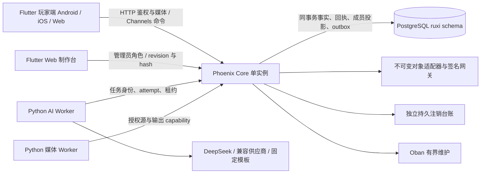

# 架构与取舍

入戏是以房间为单位的协作互动故事。玩家只持有自己的授权投影，Core 决定结果；模型负责受限提示或制作建议。

## 房间一致性

每个房间进程串行处理意图，SQL 行锁和 owner_epoch/租约提供最终写入边界。数据库时钟决定截止；命令 ID 和请求摘要绑定持久回执。操作、结构事实、每成员连续序号和 outbox 在同一个事务提交，广播失败不撤回已提交结果。

客户端把回执和视图分开处理。乱序事件进入有界缓冲，水位和持久事件分页修补缺口；已清理历史或恢复 epoch 变化时使用授权快照。Web 身份按标签页保存，原生凭证放安全存储，投影缓存受身份、代次和到期时间约束。

接管房间时核验冻结内容 hash，从 SQL 重建成员控制权、道具归属、交付、冻结选民、投票与公开时间线。业务变量和知识进度保存在事务提交的房间 JSON 中。离线挂起房间释放进程，由 Oban 处理到期，避免历史房间长期占用连接池。

## 内容与模型

内容以不可变发布版本绑定房间。白名单 AST 校验引用、变量类型、条件和效果，以 50,000 状态上限检查可达性。制作台编辑采用 revision 乐观并发；修改清空旧审核。发布同时要求有效图、实际可用媒体和当前 hash 的审核。

玩家提示只发送当前角色已获授权的信息，Core 校验阶段和知识基线，8 秒固定兜底保证玩法继续。编辑模型返回惰性文本建议，人工按原 revision/hash 应用后再审核，不接受模型状态补丁或发布指令。

上传 capability 绑定对象、大小、摘要、主体和期限。转码输出绑定 Worker 当前租约与 attempt，发布版本引用不可覆盖对象；字幕修订创建新资产。媒体 Worker 与模型 Worker 分离，解码子进程不继承供应商或任务凭证。

## 恢复与运行范围

备份恢复在独立数据库执行，先变更恢复 epoch、撤销旧认证与租约，再重放最新独立注销台账。SQL 和对象目录的备份周期、云托管持久卷、TLS、告警仍须部署验证。

当前 Core 固定单实例，媒体经应用签名网关分发。尚未实现跨实例路由或 CDN；无需为了作品演示宣称这些能力已具备。测试、演练和未执行的设备验收分别记录在 [VALIDATION.md](VALIDATION.md) 与 [QA_TRACE.md](QA_TRACE.md)。
